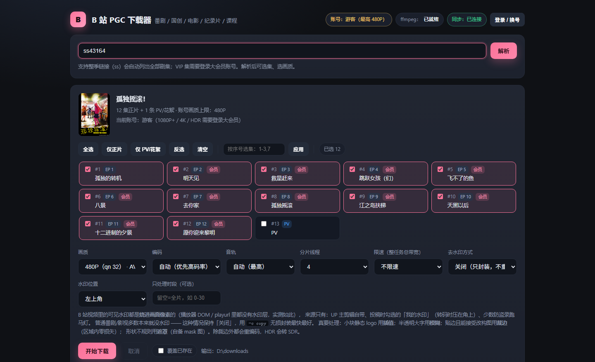
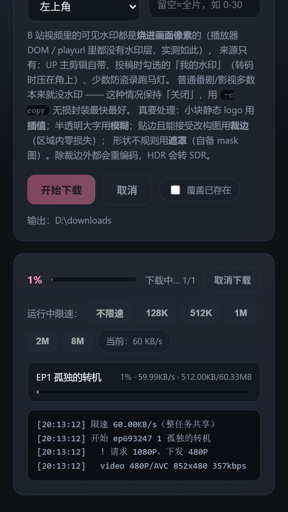

# bili-pgc-web

**哔哩哔哩 PGC 内容下载器 · 本地 Web UI**
番剧 / 国创 / 电影 / 纪录片 / 课程，支持选集、选画质、限速（运行中可调）、去水印、跨设备同步进度。

[](https://github.com/qigexiaoqi/bili-pgc-web/actions/workflows/ci.yml)


> 个人离线备份用途，非官方项目，与哔哩哔哩无关联。请遵守内容平台的用户协议，不要传播下载的内容。

---

## 特点

- **零依赖**：纯 Python 标准库（仅需系统里有 `ffmpeg`），不需要 pip 安装任何包。
- **画质可选**：8K / 4K / 1080P+ / 1080P / 720P / 480P / 360P，AVC / HEVC / AV1 编码可选，音轨可选 Hi-Res / 杜比。
- **选集灵活**：整季、指定集号（`1-3,7`）、只下 PV、按 ep_id 精确指定。
- **限速**：整任务共享令牌桶，**下载过程中随时改**，1 秒内生效。
- **去水印**：插值 / 模糊 / 马赛克 / 裁边 / 遮罩五种方式 + 多区域 + 时段，按水印形态选（详见 [docs/WATERMARK.md](docs/WATERMARK.md)）。
- **跨设备同步**：进度存在服务端，关掉网页继续下，手机打开同一地址就能看到同一份进度并随时取消。
- **断点友好**：已完成的集自动跳过；失败会汇总原因（VIP / 地区 / 下架）。

## 截图

| 桌面端 | 手机端 |
|---|---|
|  |  |

## 快速开始

### 1. 准备 ffmpeg

```bash
winget install -e --id Gyan.FFmpeg     # Windows
brew install ffmpeg                     # macOS
sudo apt install ffmpeg                 # Debian / Ubuntu
```

程序启动时会自动在 `PATH`、`./bin/`、常见安装目录里找 `ffmpeg`。

### 2. 启动

**Windows**：双击 `web.bat`（默认监听 `0.0.0.0`，会自动尝试放行防火墙 8737）。

**任意平台**：

```bash
python server.py                 # http://127.0.0.1:8737/
python server.py --host 0.0.0.0  # 手机 / 平板也能访问
python server.py --port 8800     # 指定端口（被占用会自动往后找）
```

控制台会打印版本、监听地址、局域网地址、输出目录。

### 3. 使用

1. 粘贴 `ep …` / `ss …` / `md …` 链接或 `BV` 号 → **解析**；
2. 勾选要下载的集，选画质 / 编码 / 音轨；
3. 需要限速就设一个上限（运行中还能在进度条下面改）；
4. **开始下载**，进度逐集显示；关掉网页也不影响，重新打开会自动接管。

### 4. 登录（高画质必需）

不登录时 PGC 最高 **480P**；登录后免费集可到 1080P；**大会员**才能 1080P+/4K/HDR/杜比。

- 页面右上角「登录 / 换号」→ 扫码（本机有浏览器时）或直接粘贴 `SESSDATA`；
- 凭据保存在 `cookies.txt`（已在 `.gitignore` 中，不会被提交）。

## 配置（环境变量）

| 变量 | 默认 | 说明 |
|---|---|---|
| `BILI_HOST` | `127.0.0.1` | 监听地址，局域网访问用 `0.0.0.0` |
| `BILI_PORT` | `8737` | 端口 |
| `BILI_OUTPUT` | `./downloads` | 下载目录 |
| `BILI_COOKIE` | `./cookies.txt` | Cookie 文件 |
| `BILI_PROFILE` | `./.browser-profile` | 扫码登录用的浏览器 profile |
| `BILI_TOKEN` | 空 | 设置后访问需带 `?token=…`，局域网/公网建议开启 |
| `BILI_PROXY` | 空 | HTTP 代理（海外 IP 看 PGC 必需） |
| `BILI_NO_BROWSER` | 空 | 设 `1` 则不自动打开浏览器（服务器/容器） |

## HTTP 接口

| 方法 | 路径 | 说明 |
|---|---|---|
| GET | `/healthz` | 健康检查（不受 token 限制） |
| GET | `/api/status` | 账号 / ffmpeg / 浏览器可用性 / 版本 |
| GET | `/api/state` | 上次解析的列表 + 当前任务摘要（跨设备恢复用） |
| POST | `/api/resolve` | `{"url":"…"}` → 季信息 + 剧集 + 画质 |
| POST | `/api/start` | 开始下载，字段见下 |
| GET | `/api/progress` | 任务进度（每集百分比 / 速度 / 日志） |
| POST | `/api/limit` | 运行中改限速 `{"rate_limit":512}`（KB/s，0=不限） |
| POST | `/api/cancel` | 取消当前任务（会清理半成品分片） |
| POST | `/api/cookie` | 手动设置登录态 `{"cookie":"SESSDATA=…"}` |
| POST | `/api/login` | 启动浏览器扫码登录（容器内不可用） |
| GET | `/api/cover?u=…` | 封面代理（带 Referer 取图） |

`POST /api/start` 示例：

```json
{
  "ep_ids": [693247, 693248],
  "qn": 120,
  "codec": "hevc",
  "audio": "auto",
  "threads": 4,
  "rate_limit": 512,
  "overwrite": false,
  "delogo": "tl",
  "delogo_mode": "delogo",
  "delogo_range": "0-30",
  "delogo_mask": null
}
```

## Docker

```bash
cd docker
docker compose up -d --build
```

容器内没有浏览器，登录请用页面里的「粘贴 SESSDATA」。输出在仓库根的 `downloads/`，配置在 `docker/config/`。

## 常见问题

<details>
<summary><b>手机上打不开 / 看不到进度</b></summary>

1. 服务要监听 `0.0.0.0`（`web.bat` 默认已是），控制台会打印 `局域网 : http://192.168.x.x:8737/`；
2. Windows 防火墙需放行 8737（`web.bat` 会自动尝试，失败时管理员执行
   `netsh advfirewall firewall add rule name="bili-pgc-web" dir=in action=allow protocol=TCP localport=8737`）；
3. 手机与电脑要在同一 Wi-Fi（不是 5G 流量），路由器不能开 AP 隔离；
4. 先访问 `http://电脑IP:8737/healthz`，返回 `ok` 说明通路没问题。

**注意**：电脑和 NAS 如果各跑一份，是两套独立服务，进度不互通 —— 页脚会显示
`服务端 v1.6（机器名）`，看是不是你要的那台。
</details>

<details>
<summary><b>控制台报 <code>TypeError: argument of type 'HTTPStatus' is not iterable</code></b></summary>

v1.5 的日志 bug，v1.6 已修。这类 400 通常是手机把地址当成了 `https://`——本服务是纯 HTTP，
请用 `http://IP:8737/`。v1.6 会直接回一段纯文本提示。
</details>

<details>
<summary><b>只有 480P / 4K 是灰的</b></summary>

游客上限 480P；登录后免费集 1080P；1080P+/4K/HDR/杜比需要大会员账号的 `SESSDATA`。
另外有些片子本身就没有更高画质，页面日志会写明「该内容本身没有更高画质」。
</details>

<details>
<summary><b>下载后没有 mp4，只有 .m4s</b></summary>

没找到 ffmpeg。装好后重跑会自动合并。
</details>

<details>
<summary><b>去水印把画面糊了一块</b></summary>

`delogo` 是插值，纯色/大面积背景上会糊。水印贴边就选「裁边」（区域内零损失），
半透明大字选「模糊」，形状不规则选「遮罩」。原理与实测对比见 [docs/WATERMARK.md](docs/WATERMARK.md)。
</details>

## 已知限制

- PGC 内容受地区限制，海外 IP 需要 `BILI_PROXY` 指向国内代理；
- DRM 保护的内容（`drm_tech_type > 0`）只能导出加密文件，需自行处理；
- 去水印会重编码，HDR 片源会转 SDR；
- 支持 PGC（番剧/影视/课程）与普通投稿单集；不支持直播。

## 开发

```
.
├─ server.py           HTTP 服务 + 任务调度
├─ core.py             下载内核（WBI 签名 / playurl / DASH / ffmpeg / 登录）
├─ index.html          单页前端（原生 JS，无构建）
├─ web.bat             Windows 启动器
├─ docs/WATERMARK.md   水印原理与去水印方案实测
├─ docker/             Dockerfile + compose
└─ .github/workflows/  CI（语法检查 + 冒烟测试）
```

本地验证：

```bash
python -m py_compile server.py core.py
BILI_NO_BROWSER=1 python server.py --port 8123 &
curl -fsS http://127.0.0.1:8123/healthz
```

## 许可

[MIT](LICENSE)
